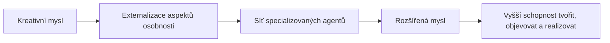

# CEA - Cybernetic Exocortex Architecture

## Východisko

Dokument představuje nový přístup k využívání velkých jazykových modelů (LLM). Nejde o používání generativní AI jako nástroje pro získávání hotových odpovědí, ale o její zapojení do procesu tvorby a strukturování myšlení. Namísto formulování požadavků na konečný výstup uživatel sdílí své pracovní poznámky, neúplné úvahy, mentální modely, dílčí hypotézy a roztříštěné informace.

Úkolem AI není dodat jedno hotové řešení, ale odhalit skryté souvislosti, identifikovat logické mezery, zpřehlednit vztahy mezi jednotlivými prvky a ukázat možné systémové důsledky.
Cílem je projít s pomocí AI celý proces geneze nějaké změny v širokém komplexním měřítku.
Tento přístup převádí část kognitivního procesu do externího prostředí, kde může být dále analyzován a rozvíjen. Když AI vrací strukturovanou reprezentaci uživatelova myšlení, usnadňuje rozpoznávání vzorců, souvislostí a příležitostí, které by jinak zůstaly skryty v informačním a mentálním šumu.

Vzniká tak zpětnovazební kybernetická smyčka mezi člověkem a umělou inteligencí. Člověk do ní vnáší záměr, intuici, zkušenost a kreativitu; AI přispívá schopností organizovat informace, sledovat komplexní vazby a systematicky rozvíjet alternativní pohledy. Výsledkem není automatizace myšlení, ale jeho rozšíření. LLM se v tomto pojetí stává kognitivním partnerem, který pomáhá zvyšovat tvůrčí i analytickou kapacitu člověka tím, že biologické a algoritmické procesy spolupracují v rámci jediného integrovaného systému.

Vytváříme kybernetickou smyčku, která zvyšuje tvůrčí produktivitu člověka tím, že nechává biologii a algoritmy dělat to, co umí nejlépe. Cílem není využít tuto kombinaci co nejlépe, ale stavět na tom co již známe a máme k dispozici. Cílem je vytvořit systém takový, jaký bychom jej chtěli - s člověkem uprostřed.


## Rozšířená mysl

Kreativní mysl je zdrojem novosti. Je místem, kde vznikají nápady, nové perspektivy, hypotézy a nečekaná propojení. Její největší hodnota nespočívá v administrativě, koordinaci nebo správě informací, ale ve schopnosti vytvářet nové koncepty.

Cílem architektury je rozšířit tuto kreativní mysl do soustavy specializovaných agentů, které reprezentují její jednotlivé aspekty a propojují ji s reálným světem. Vzniká tak rozšířená kognitivní soustava, ve které lidská kreativita získává nové smysly, paměť, analytické schopnosti a realizační kapacity.
Kreativní centrum zůstává zdrojem směru, významu a novosti. Agenti působí jako jeho externí kognitivní orgány.


Inspirací je Minskyho představa mysli jako společnosti specializovaných procesů. Každý proces řeší určitou oblast poznávání světa a jejich součinnost vytváří schopnost myslet, rozhodovat a tvořit.
V této architektuře se část těchto procesů přesouvá mimo biologický mozek. Vzniká exokortex, tedy externí vrstva mysli tvořená specializovanými inteligentními agenty.
Kreativní centrum a agentní vrstva dohromady tvoří jeden funkční celek.




---

## Agenti jako aspekty osobnosti

### Operator

Reprezentuje pozornost a exekutivní činnost, komunikuje s okolím lidským způsobem.

Sleduje okolí, zachycuje podněty, organizuje komunikaci a chrání kreativní centrum před zahlcením. Funguje jako filtr mezi myslí a okolním světem.

### Keeper

Reprezentuje dlouhodobou paměť, správce zdrojů.

Udržuje a organizuje dokumenty, znalosti, zařízení, kontakty, soubory a další aktiva. Uchovává souvislosti mezi informacemi tak, aby mohly být kdykoli znovu využity.

### Specter

Reprezentuje představivost, asociace a alternativní pohledy, tvorba vizí a zadání.

Pracuje s možnostmi budoucnosti, pomáhá přerámovávat problémy a vytvářet nové perspektivy. Je zdrojem nových interpretací a konceptuálních skoků.

### Scientist

Reprezentuje zvědavost a tvorbu hypotéz, objevuje nové.

Vyhledává rozpory, anomálie a nezodpovězené otázky. Rozšiřuje hranice poznání a otevírá nové směry myšlení.

### Psychologist

Reprezentuje modelování lidského světa, rozumí lidem.

Pomáhá chápat motivace, potřeby a chování jednotlivců i skupin. Umožňuje kreativním myšlenkám získat podobu srozumitelnou a hodnotnou pro ostatní lidi.

### Formalist

Reprezentuje normativní a systémové struktury, hlídá soulad s pravidly.

Posuzuje návrhy vzhledem k pravidlům, právu, standardům a formálním omezením světa.

### Business

Reprezentuje hodnotu a prosperitu, zajišťuje ekonomickou životaschopnost.

Posuzuje potenciál záměrů, hledá oblasti s vysokým přínosem a propojuje kreativitu s ekonomickou realitou.

### Programmer

Reprezentuje konstrukční schopnost, implementátor efektivních řešení.

Převádí abstraktní myšlenky do vykonatelných systémů, algoritmů a software.

### Engineer

Reprezentuje realizaci a provoz ve skutečném prostředí.

Přeměňuje koncepty v provozovatelné a funkční systémy. Zajišťuje přechod od myšlenky k reálnému nasazení.

---

## Tok kreativity

Architektura je uspořádána jako síť vztahů mezi aspekty osobnosti.
Kreativní centrum se nachází v těžišti systému a jednotliví agenti představují směry, kterými se kreativita promítá do reality.

Celá síť tvoří pomyslný trojůhelník, jehož vrcholy jsou nejsilnější kontaktní body s realitou (Operator, Formalist, Engineer), dávají kretivitě reálný rámec. Tyto body kontaktu plní ve všech případech ochrannou funkci kreativního jádra, jsou filtry pro rušivé vnější podněty. Trojúhelníková struktura zajišťuje rovnováhu mezi lidmi, poznáním a praktickou aplikací výsledků.
### Sociální transformace myšlenek

```text
Operator
↓
Keeper
↓
Psychologist
↓
Formalist
```

Tato linie převádí kreativní impulzy do lidského a společenského prostředí.

### Poznání a inovace

```text
Operator
↓
Specter
↓
Scientist
↓
Engineer
```

Tato linie rozvíjí inspiraci do podoby nového poznání a inovací.

### Realizace

```text
Engineer
↓
Programmer
↓
Business
↓
Formalist
```

Tato linie převádí poznání do konkrétních produktů, služeb a systémů.

---

## Exokortex

Celý systém lze chápat jako exokortex, tedy externí rozšíření lidské mysli.
Každý agent představuje specializovaný kognitivní orgán. Společně vytvářejí prostředí, ve kterém může kreativní centrum pracovat s větším kontextem, hlubší pamětí, širším záběrem a vyšší realizační kapacitou.

Výsledkem je mysl schopná dlouhodobě pracovat s komplexními projekty, objevovat nové směry a přetvářet je do praktické reality.

---

## Definice

**Kybernetická exokortexová architektura pro kreativní mysl** je systém, ve kterém jsou jednotlivé aspekty osobnosti externalizovány do specializovaných inteligentních agentů. Tito agenti rozšiřují schopnost člověka vnímat, pamatovat si, interpretovat, objevovat a realizovat. Kreativní mysl zůstává centrem systému a prostřednictvím agentů se promítá do reálného světa ve větším měřítku, s vyšší přesností a vyšší účinností.
