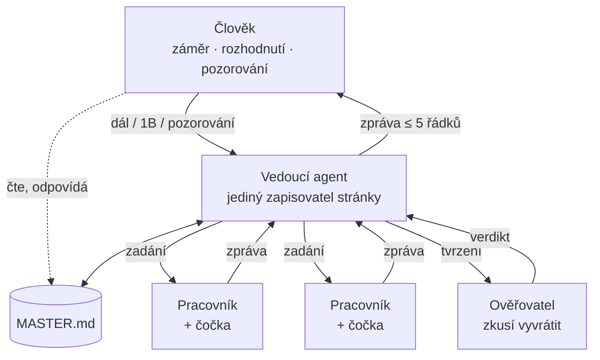

# Master

Návrh nástroje, který plní [účel kitu](purpose.md) a odstraňuje slabiny popsané v [review](review.md). Prototyp je ve složce [`master/`](../master/) a kit ho sám používá v [`MASTER.md`](../MASTER.md).

## Myšlenka

Dnes člověk tlačí práci skrz agenty: vybírá roli, píše vstup, kopíruje výstup a pamatuje si, kde skončil. Master tok otáčí. Práci táhnou agenti a člověka si zavolají jen pro tři věci, které umí jen on:

- **záměr:** co chceme a proč, co agenti smějí sami a na co se musí zeptat;
- **rozhodnutí** na jednosměrných dveřích: nevratné kroky, kroky navenek, volby mezi hodnotami;
- **pozorování z reality:** co se stalo na budově, co řekl partner, co ukázala data.

Všechno ostatní dělá hierarchie agentů a udržuje to pravdivé na jedné hlavní stránce, `MASTER.md` v kořeni projektu. Funguje to jako velín elektrárny. Operátor nečte logy, dívá se na jednu obrazovku, kde je jen to, co vyžaduje jeho zásah, a každý alarm má doporučenou reakci.

Nástroj jsou tři soubory v [`master/`](../master/) a jedna stránka v projektu:

- [`protocol.md`](../master/protocol.md): asi 70 řádků pro vedoucího agenta;
- [`MASTER.template.md`](../master/MASTER.template.md): šablona stránky;
- [`check.py`](../master/check.py): kontrola stránky bez závislostí a přehled otevřených otázek přes všechny projekty.

## Stránka

### Příklad

Smyšlený projekt, ale se skutečnými invarianty z `asset-ontology`:

```markdown
# Master — EMO pilot, budova B

## Rozhodni

1. **Pustit plánovač baterie na skutečný střídač?** A) ano, 2 týdny ve špičkách · B) týden jen jako doporučení operátorovi · C) zatím ne
   Doporučuji B: backtest prošel, ale chování operátora neznáme a zápis do střídače je krok navenek. Bez odpovědi: připravím B a čekám. Podklady: specs/004-battery-plan/plan.md
   →
2. **Sdílet data HDO s ČEZ?** A) jen agregovaná · B) ne · C) až po konzultaci s právníkem
   Doporučuji C: smlouva o datech sdílení neřeší. Bez odpovědi: nic nesdílím. Podklady: docs/data-sharing.md
   →

## Víme

- ▶ Plánovač sníží náklady o ≥ 8 % proti dnešnímu pravidlu — ověříme: backtest srpen–září, práh 8 % → větev emo/battery-plan
- ~ Data BMS a střídače po minutě od 1. 8. 2026, výpadky pod 1 % → data/quality/2026-09.md
- ~ Základní úroveň nákladů 12 480 Kč za měsíc → notebooks/baseline.ipynb
- ✓ Konektor převádí kW na W právě jednou → tests/test_units.py
- ✗ RC model předpoví zatížení s chybou pod 0,5 kW; MAE vyšla 0,8 kW → specs/003-load-forecast/research.md
- ? Operátor se bude doporučeními řídit → chybí: týden provozu

## Záměr

Cíl: snížit náklady budovy B na energii řízením baterie, bez zásahu do komfortu.
Hotovo, když: měsíc řízení na skutečném střídači s úsporou ≥ 8 % a bez stížností provozu.
Agenti smí sami: číst data, backtesty, kód a testy v pracovní větvi, rešerše.
Vždy se mě zeptej: zápis do střídače, cokoli směrem k ČEZ nebo provozovateli, merge do main.
Platí vždy: `*In` a `*Out` jsou nezáporné velikosti, znaménko má jen neutrální `power`. Konfigurace v kW, InfluxDB ve W, převod právě jednou.

## Rozhodnuto

- 2026-09-18 · základní úroveň = dnešní pravidlo nabíjení v noci · člověk (doporučeno)
- 2026-09-16 · plánovač jako MILP s horizontem 24 h · agent
- 2026-09-12 · místo RC modelu zkusit gradient boosting · člověk (jinak)
```

### Proč právě tyto čtyři oddíly

| Oddíl | Co v něm je | Kdo píše |
|-------|-------------|----------|
| Rozhodni | nejvýš 3 otázky s možnostmi, doporučením a postupem bez odpovědi | agent; člověk odpovídá za `→` nebo v chatu |
| Víme | tvrzení se stavem důkazu a odkazem na důkaz | agent; člověk dodává pozorování |
| Záměr | cíl, konečný stav, meze autonomie, invarianty | jen člověk |
| Rozhodnuto | posledních asi 10 rozhodnutí a kdo je udělal | agent |

- **Rozhodni** je seznam alarmů. Je nahoře, protože je to jediné, co člověk musí udělat.
- **Víme** je kniha tvrzení. Každé tvrzení nese stav důkazu, a tak Víme nahrazuje stupně zralosti i TRL: zralost projektu je jen pohled na to, která tvrzení jsou ověřená. Z Víme se skládá článek, návrh projektu i zpráva pro TAČR.
- **Záměr** je velitelský záměr: cíl, konečný stav, meze a invarianty, které platí vždy. Mění se zřídka a píše ho jen člověk.
- **Rozhodnuto** říká, proč jsou věci tak, jak jsou, a kdo o nich rozhodl. Zároveň měří, jak často člověk přijímá doporučení.

Na stránce záměrně chybí seznam úkolů, historie, plány a souhrny sezení. Úkoly patří agentům (Spec Kit, větve), historie je git log stránky, plány jsou ve `specs/` a souhrnem sezení je stránka sama.

## Jak to vypadá v praxi

Ráno napíšeš do chatu **1B 2C**.

Vedoucí agent načte stránku a obě odpovědi zapíše do Rozhodnuto jako `člověk (doporučeno)`. Rozpracovanou sázkou je backtest plánovače. Agent zadá dvěma pracovníkům backtest pro srpen a pro září a třetímu kontrolu, jestli se někde nepřevádějí jednotky dvakrát. Ověřovatel s čistým kontextem pak zkusí výsledek vyvrátit, například hledá, jestli backtest nepoužívá data z budoucnosti. Agent upraví stránku, spustí kontrolu a odpoví:

> Backtest: úspora 9,4 % při prahu 8 %, ověřovatel nenašel únik budoucích dat. Sázka je teď ověřená.
> Nová sázka: týden doporučení operátorovi, jak jsi zvolil. Připravuji export doporučení.
> V Rozhodni nic nečeká.

Odpoledne ti technik řekne, že střídač má každý den od 14:00 do 14:30 servisní okno. Napíšeš to agentovi jednou větou. Agent to zapíše do Víme jako `~` se zdrojem „technik, 23. 9.“ a plánovač okno respektuje.

Druhý den Cursor nejede, tak otevřeš Codex a napíšeš **dál**. Codex si přečte `AGENTS.md` a stránku a naváže tam, kde Cursor skončil.

Za dva dny jsi napsal tři krátké zprávy a přečetl dvě pětiřádkové odpovědi. Nevybíral jsi roli, nekopíroval prompt a nic sis nemusel pamatovat.

## Hierarchie agentů



- **Vedoucí agent** jako jediný zapisuje stránku a mluví s člověkem. Drží malý kontext a skládá rozhodnutí. Tím se vyhne konfliktům paralelních zapisovatelů, na které upozorňuje Cognition.
- **Pracovníci** dostanou zadání, pracují ve vlastním kontextu (subagent v Cursoru nebo Claude Code, případně vlastní větev) a vrátí zprávu. Pracovník může delegovat dál ve stejném tvaru.
- **Ověřovatel** je pracovník, který tvrzení nevytvořil a má ho vyvrátit. Kde to jde, spouští spustitelný hodnotitel: testy, backtest, porovnání se základní úrovní.
- **Čočka** je odborná znalost, kterou vedoucí přidá pracovníkovi do zadání: `field-chain`, `scientific-optimization`, `projectant`, `business` nebo Spec Kit. Člověk si roli nevybírá.

Zadání a zpráva mají stejný tvar na každé úrovni:

| | Zadání dolů | Zpráva nahoru |
|-|-------------|---------------|
| 1 | Proč: věta ze Záměru a sázka | Výsledek |
| 2 | Výstup a jak se ověří | Důkaz: odkazy |
| 3 | Meze: co nesmí, rozpočet | Nejistota a meze |
| 4 | Vstupy: soubory, data, zjištění | Potřebuji |

Mezi člověkem a vedoucím agentem platí totéž: Záměr je zadání a stránka je zpráva. Nad projekty proto může být Master celého ekosystému `team-me`. Jeho Záměr by držel společné kontrakty z `ecosystem-plan.md` a projektové stránky by na něj odkazovaly řádkem „Nadřazený záměr: ../MASTER.md“.

## Sedm pravidel

1. **Dveře.** Vratné kroky dělají agenti sami, jednosměrné rozhoduje člověk. Hranici píše člověk do Záměru. (Bezos, dopis akcionářům 2015; mission command.)
2. **Otázka za minutu.** Každá otázka má možnosti, doporučení a postup pro případ, že člověk neodpoví. Vybrat je snazší než vymyslet a přípravu má udělat agent. (Alarm management: každý alarm s doporučenou reakcí; Agent Inbox.)
3. **Nejvýš tři.** Otevřené jsou nejvýš tři otázky. Pracovní paměť udrží asi čtyři celky a velín, na kterém svítí všechno, nikdo nesleduje. (Cowan 2001; EEMUA 191.)
4. **Víme jen s důkazem.** Tvrzení se povýší až po hodnotiteli a pokusu o vyvrácení. Vyvrácené zůstává. (Pole `passes` v harnessu Anthropicu; kázeň v důkazech z dnešního kitu.)
5. **Jedna stránka.** Nejvýš 60 řádků. Co se nevejde, patří do odkazovaného souboru. Stránka je rozhraní, archivem je git. (Soubor s průběhem v harnessu Anthropicu; plán v Ralph loop.)
6. **Hodnotitel napřed.** Sázka má hodnotitele a práh dřív, než začne práce, a během práce se nemění, takže se nedá posunout branka. (Předregistrace ve vědě; AlphaEvolve.)
7. **Tření je signál.** Každá oprava od člověka se stane návrhem jedné věty do „Platí vždy“ a každá mez protokolu návrhem změny kitu. Protokol neroste: za přidanou větu jednu odebranou.

Co z pravidel 2 až 6 jde zkontrolovat strojově, hlídá `check.py`.

## Posuvník autonomie

Autonomie není nastavení nástroje, ale řádek „Agenti smí sami“ v Záměru a člověk ho posouvá podle dat. U každého lidského rozhodnutí se v Rozhodnuto zaznamená, jestli člověk přijal doporučení (`člověk (doporučeno)`), nebo rozhodl jinak (`člověk (jinak)`).

Když člověk přijme aspoň 9 z 10 doporučení, kontrola navrhne přesunout takové rozhodnutí do „Agenti smí sami“. Když jich přijme polovinu nebo méně, agenti Záměr nechápou a kontrola navrhne ho zpřesnit. Odpověď „zbytečná“ znamená, že takovou otázku měli agenti rozhodnout sami. Autonomie tak roste s doloženou důvěrou, ne s nadšením.

## Co se stane se zbytkem kitu

| Dnes | S Masterem |
|------|-----------|
| stupně 1, 2, 3 a kaskáda | pohled na Víme; stupeň nebo TRL pro poskytovatele odvodí agent, když je potřeba |
| role Engineer, Scientist, Business, Projectant a 14 vyvolávacích příkazů | čočky, které vedoucí přidá pracovníkovi |
| skills `field-chain` a `scientific-optimization` | beze změny, jako čočky |
| Spec Kit, preset `devl-spiral` a `backbone.md` | nástroj pro větší softwarové sázky, spouští ho agent |
| `prompts/takeover.md` | krok Start v protokolu |
| `prompts/doctor.md` | `master/check.py` |
| ADR | beze změny; Rozhodnuto na ně u velkých rozhodnutí odkazuje |
| devlog, handoff a TODO v projektech | `MASTER.md` a git log |

`docs/conventions.md` zakazuje devlog, handoff a paralelní záznamy stavu. Master je s tím v souladu, protože je jediným záznamem stavu.

## Nasazení do projektu

1. Přidej kit jako submodul, pokud v projektu ještě není:

   ```
   git submodule add -b main https://github.com/m4rt1n3k/ai-promptkit.git extern/ai-promptkit
   ```

   Projekty, které kit už připínají, musí posunout submodul na verzi s Masterem.
2. Do `AGENTS.md` přidej jeden řádek:

   ```
   Jsi vedoucí agent projektu: postupuj podle extern/ai-promptkit/master/protocol.md.
   ```

3. Pro Claude Code vytvoř `CLAUDE.md` s řádkem `@AGENTS.md`. Cursor i Codex čtou `AGENTS.md` samy.
4. Napiš agentovi **dál**. `MASTER.md` zatím neexistuje, a tak agent provede Start: přečte projekt, navrhne Záměr a zeptá se, jestli platí.

Přehled otevřených otázek ve všech projektech najednou: `python extern/ai-promptkit/master/check.py --inbox ..`

## Jak poznáme, že funguje

Master je sám sázka a platí pro něj stejná pravidla. Pilot trvá dva týdny v jednom projektu, hodnotitel a prahy jsou dané předem:

| Měřítko | Práh | Jak se měří |
|---------|------|-------------|
| čas člověka na projekt | ≤ 10 min denně | odhad člověka na konci dne a počet jeho zpráv |
| studený start | ≤ 2 min, bez vysvětlování | nové sezení v jiném nástroji a zpráva „dál“ |
| rozhodnutí jen v chatu | 0 | člověk na konci pilotu projde, co rozhodl |
| zbytečné otázky | nejvýš 1 z 5 | odpovědi „zbytečná“ v gitu stránky |
| kontrola stránky | bez chyb po každé otočce | `check.py` |

Když prahy nevyjdou, Master se opraví nebo zahodí a výsledek se zapíše do Víme kitu jako `✗`.

## Rizika

- **Ověřovatel má stejné slepé skvrny jako autor.** Kde to jde, rozhoduje spustitelný hodnotitel: testy, backtest, porovnání se základní úrovní. Jinak ověřuje jiný model nebo jiný nástroj.
- **Razítkování.** Člověk začne potvrzovat bez čtení (Bainbridge). Proto se ptáme jen na jednosměrné dveře, nejvýš třikrát, a vysoký podíl přijetí vede k větší autonomii, ne k dalším otázkám. Pozorování z reality zůstává aktivní prací člověka.
- **Stránka nabobtná.** Limit 60 řádků hlídá `check.py`, podrobnosti jsou v odkazovaných souborech.
- **Souběh.** Dvě sezení zapisují stránku naráz. Na projekt je jeden vedoucí agent, paralelní práce běží ve větvích a stránku zapisuje jen vedoucí.
- **Nástroje se mění.** Protokol je markdown bez vazby na konkrétního agenta a Spec Kit je jen jedna z čoček. Jediný kód je kontrola bez závislostí.
- **Citlivá data.** `MASTER.md` je v gitu. Nepatří do něj hesla, osobní údaje ani důvěrná data partnerů, jen odkaz na místo, kde jsou.

## Co je na tom nového

Jednotlivé části existují: stav na disku (harness Anthropicu, Ralph loop), fronta rozhodnutí (Agent Inbox), vedoucí agent a pracovníci (Anthropic, Claude Code, Cognition), záměr a meze (mission command), rozpočet alarmů (EEMUA 191), hodnotitel napřed (AlphaEvolve, předregistrace). Nové jsou tři věci:

1. **Člověk nikdy nepíše strukturovaný vstup.** Odpovídá písmenem, dodává pozorování a občas upraví Záměr. Všechno ostatní dělají agenti.
2. **Jedna kniha tvrzení pro kód, vědu i granty.** Stejné `✓` je test v konektoru, výsledek v článku i řádek ve zprávě pro TAČR. Zralost a TRL jsou jen pohled na ni.
3. **Autonomie roste z dat.** Podíl přijatých doporučení říká, kde agentům věřit víc.

Stejně důležité je, co v Masteru chybí: seznam úkolů pro člověka, role k vyvolávání, stupnice zralosti, workflow engine a 12 000 slov pravidel.

## Další kroky

1. Odpovědět na tři otázky v [`MASTER.md`](../MASTER.md) tohoto repa.
2. Při volbě B commitnout Master do kitu, posunout submodul v pilotním projektu a dva týdny ho používat.
3. Podle výsledku pilotu dál: Master pro celý `team-me` se společnými kontrakty ekosystému; noční automatizace, která projde projekty a ráno nabídne otázky; překlad do angličtiny, pokud kit půjde ven.
